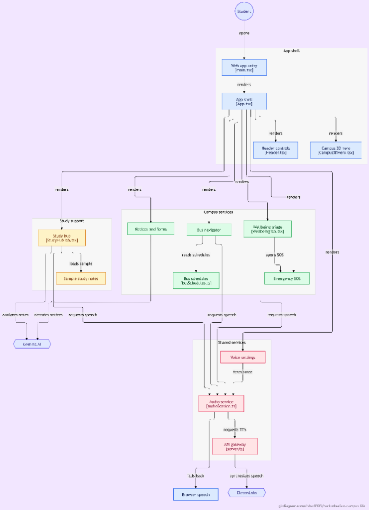
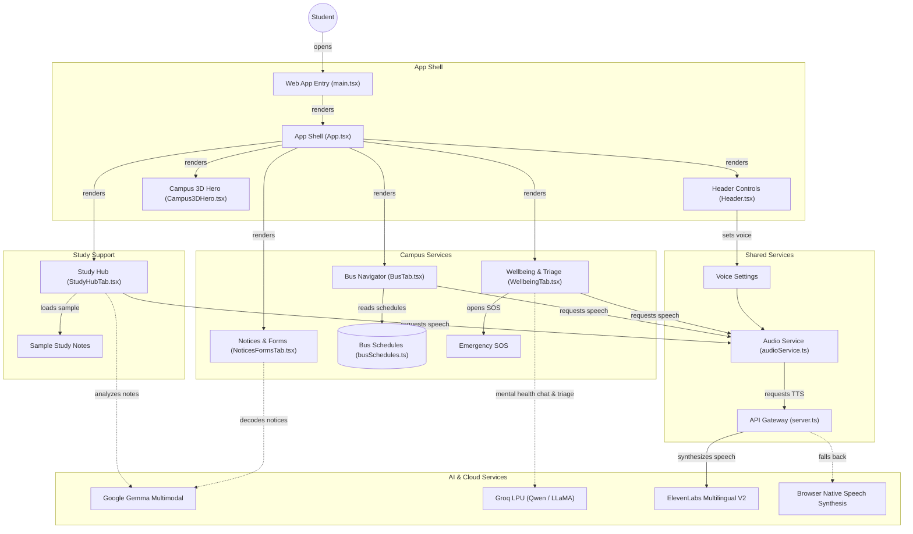
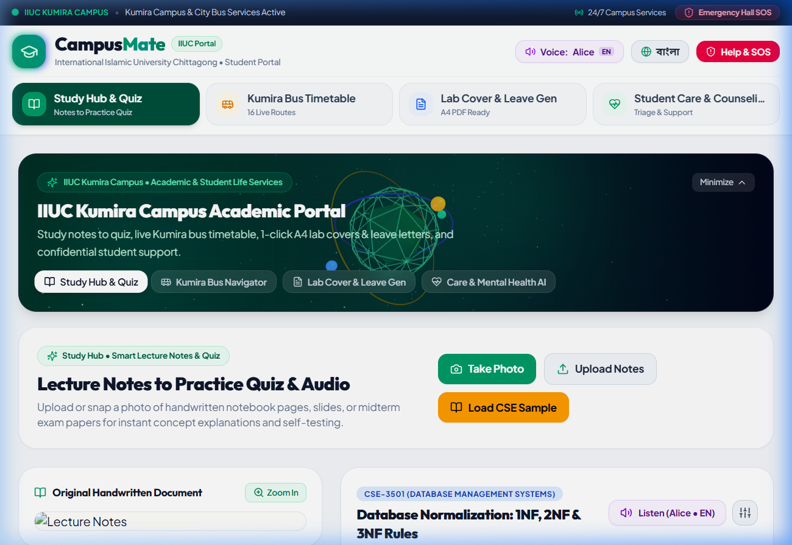
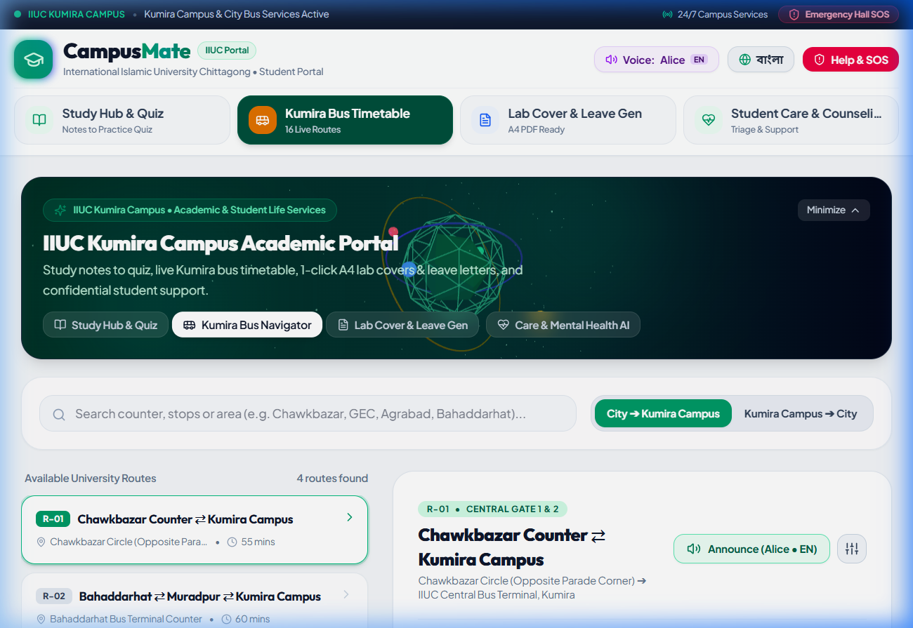
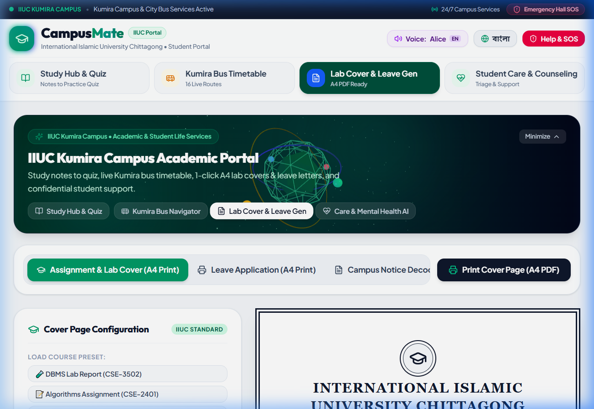
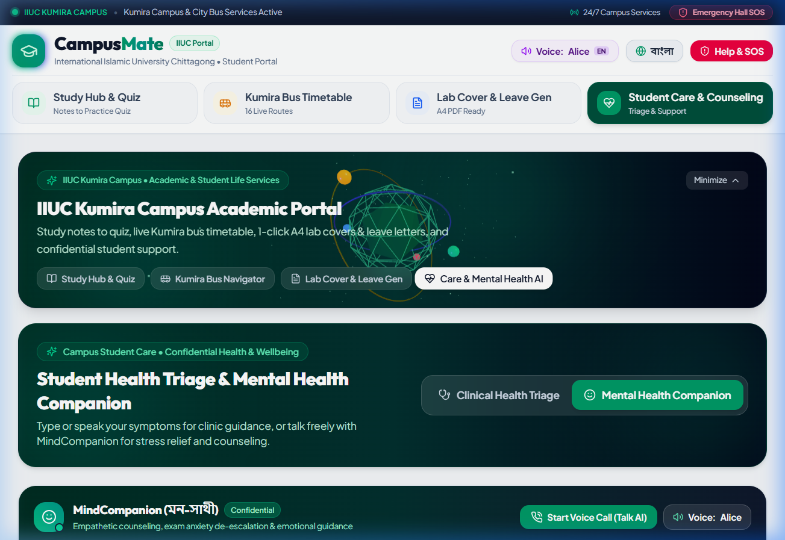

# IIUC CampusMate (ক্যাম্পাস-সাথী)
An AI-powered campus life copilot that decodes handwritten lecture notes into practice quizzes, tracks Kumira university bus schedules with real-time alerts, generates official A4 academic leave applications and lab report covers, and provides speech-enabled student medical triage and mental health counseling for IIUC students.

## The problem
Over 20,000 university students commuting to and living at the International Islamic University Chittagong (IIUC) campus in **Kumira, Sitakunda (25km outside Chittagong city)** face severe daily bottlenecks:
- **Transport Uncertainty:** Commuting across 16 major city routes (Chawkbazar, GEC, Bahaddarhat, Agrabad, etc.) leaves students stranded without real-time knowledge of next bus departure times, counter gates, or weekend schedules. Today, students rely on scattered Facebook group posts and frantic phone calls.
- **Academic Bureaucracy & Red Tape:** Missing an exam or lab due to illness requires submitting strict, formatted leave letters to Chairmen and Deans within 3 days; students often fail or lose marks because they lack the required official application format.
- **Unorganized Handwritten Notes:** Lecture notes and past exam papers remain trapped as unorganized photos in mobile galleries, with no quick way to extract formulas or self-test understanding before exams.
- **Nighttime Sickness & Academic Stress:** Students living in Usman and Ali dormitories far from the city struggle with late-night health emergencies, not knowing whether to visit the campus medical center or seek urgent hospital care, alongside overwhelming pre-exam mental anxiety.

## The solution
**IIUC CampusMate** is a bilingual (English & বাংলা) student portal built specifically for the IIUC Kumira campus community. 
Students can snap a photo of any handwritten lecture note or past paper to get an instant concept summary and an interactive 3-question self-test practice quiz with natural speech read-aloud. 
The live Kumira Bus Timetable provides real-time departure countdowns, counter gates, and audio travel announcements across all 16 city-campus routes. 
Additionally, the platform generates 1-click official A4 printable academic leave applications and lab report covers, provides voice-enabled physical symptom clinical triage, and features an empathetic interactive AI counselor for exam stress and mental health support.

## How it works
- **Model(s) used:**
  - **[Gemma 4 / Multimodal Vision & Language](https://ai.google.dev/gemma):** Transcribes handwritten lecture notes, past exam papers, and notice boards into structured summaries, key formulas, and self-test quizzes.
  - **[Qwen 3.8 / LLaMA on Groq](https://groq.com/):** High-speed LLM inference engine providing sub-300ms response times for the Student Mental Health Counselor and symptom clinical triage.
  - **[ElevenLabs Multilingual V2](https://elevenlabs.io/):** Ultra-realistic voice synthesis for study note read-alouds, bus departure announcements, and live voice conversation mode in mental health counseling (with native Web Speech API fallback).
- **Tech stack:**
  - **Frontend:** React 19, TypeScript, Tailwind CSS v4, Three.js (interactive 3D campus core), Lucide React, Vite.
  - **Backend:** Node.js, Express, `@google/genai` SDK, Groq Cloud API, ElevenLabs REST API.
  - **Deployment & Containers:** Docker (Alpine multi-stage), Render Blueprint (`render.yaml`), Railway.
- **Datasets (if any):**
  - **[IIUC Kumira Transport Schedule](https://www.iiuc.ac.bd/):** Authentic 16-route Chittagong City ⇄ Kumira Campus bus timetables, counter boarding gates, and stop timelines.
  - **Sample CSE Academic Materials:** Verified handwritten lecture note datasets (CSE-3501 Database Normalization, Algorithms, Software Engineering).

## Architecture




## How to run it
1. **Clone the repo**
   ```bash
   git clone https://github.com/rishat8903/Hacktoberfest-Campus_life.git
   cd Hacktoberfest-Campus_life
   ```

2. **Install requirements**
   ```bash
   npm install
   ```
   *(Optional)* Copy `.env.example` to `.env` and set your API keys:
   ```bash
   cp .env.example .env
   ```
   *(Note: The application includes offline curriculum fallbacks and preloaded samples, so all core features work even without active API keys).*

3. **Run the app**
   ```bash
   npm run dev
   ```
   Open [http://localhost:3000](http://localhost:3000) in your browser.
   To run in production mode:
   ```bash
   npm run build
   npm start
   ```

## Screenshots / demo
- **Study Hub & Handwritten Notes to Quiz:**
  

- **Kumira Bus Timetable & Route Navigator:**
  

- **A4 Lab Report Cover & Academic Leave Generator:**
  

- **Student Care, Symptom Triage & AI Mental Health Counselor:**
  

## What's not done yet
- **Live GPS Fleet Tracking:** Currently relies on scheduled university timetables with countdown timers; physical GPS tracker hardware integration on university buses is planned.
- **Automated University Portal Integration:** Notice extraction requires uploading/photographing paper notice boards; direct scraper integration with the university's internal notice board is pending official API access.
- **Mobile Push Notifications:** Scheduled bus alerts currently require an active browser tab; background Web Push notifications via Service Worker (PWA) on mobile devices are under active development.

## Credits
- **[Google Gemma](https://ai.google.dev/gemma):** Multimodal document & handwritten note analysis.
- **[ElevenLabs](https://elevenlabs.io/):** Multilingual voice synthesis (Voice ID `Xb7hH8MSUJpSbSDYk0k2`).
- **[Groq](https://groq.com/):** Low-latency LPU inference for real-time triage and mental health counseling.
- **[Three.js](https://threejs.org/):** Interactive 3D WebGL campus core visualization.
- **[Lucide React](https://lucide.dev/):** UI icon system.
- **[Tailwind CSS](https://tailwindcss.com/):** Modern responsive styling.
- **Organized for:** Hacktoberfest Chittagong x IEEE Computer Society IIUC Student Branch Chapter.
